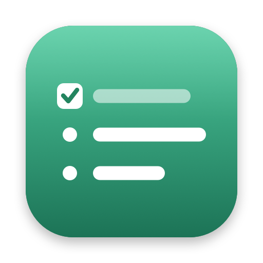
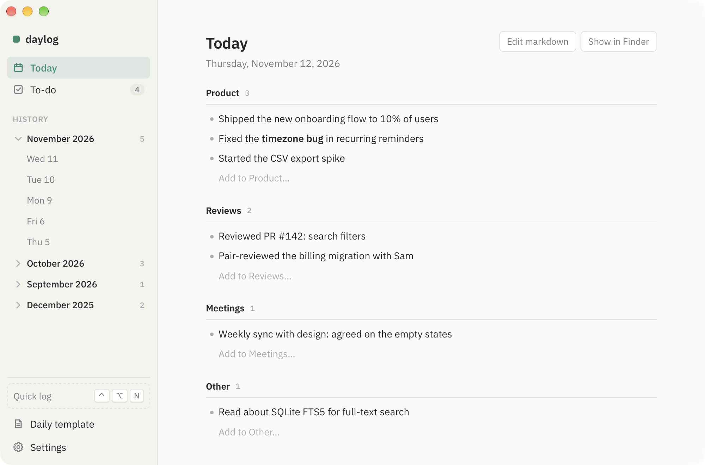
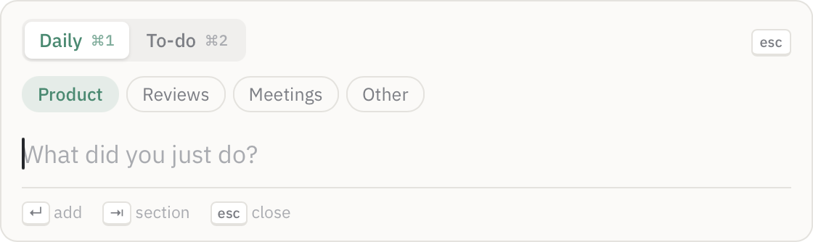
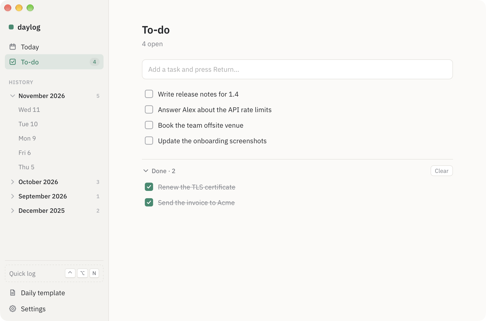
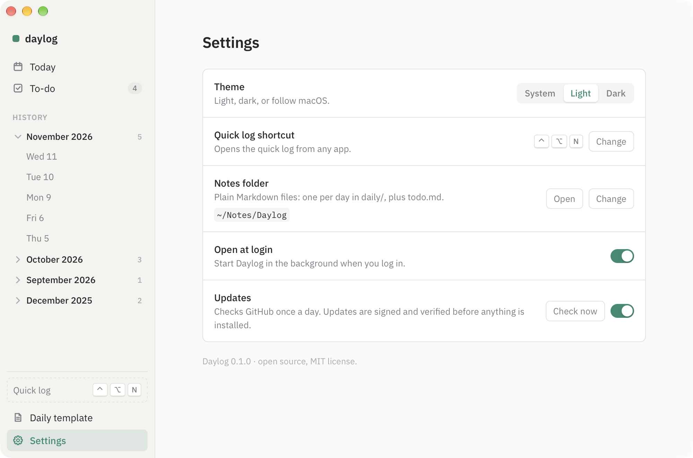

<p align="center">
  
</p>

<h1 align="center">Daylog</h1>

<p align="center">
  Log what you do, as you do it. Review your day in one place.<br>
  A tiny macOS app for daily notes and a to-do list, stored as plain Markdown.
</p>

<p align="center">
  <a href="https://github.com/Pierrickgard/daylog/releases/latest"></a>
  <a href="https://github.com/Pierrickgard/daylog/actions/workflows/build.yml"></a>
  
  <a href="https://github.com/Pierrickgard/daylog/actions/workflows/codeql.yml"></a>
  <a href="https://scorecard.dev/viewer/?uri=github.com/Pierrickgard/daylog"></a>
  <a href="LICENSE"></a>
</p>

<p align="center">
  <picture>
    <source media="(prefers-color-scheme: dark)" srcset="docs/today-dark.png">
    
  </picture>
</p>

## Why

At the end of the day it's hard to remember everything you did. Daylog makes writing it down cost two seconds:
press a shortcut from any app, type one line, hit Return, and you're back where you were. In the evening, open
Daylog and your day is there, sorted by section.

<p align="center">
  <picture>
    <source media="(prefers-color-scheme: dark)" srcset="docs/quick-log-dark.png">
    
  </picture>
</p>

## Features

- **Quick log from anywhere**: a global shortcut (default **⌃⌥N**, Control + Option + N) opens a small popup
  over the app you're in, without bringing Daylog's window forward. Pick **Daily** or **To-do**, pick a section,
  type, Return.
- **One note per day**: each line goes under a section of today's note. Sections come from your template,
  so you organise days your way (projects, clients, apps…). Add, edit or delete lines right in the day view,
  or edit the raw Markdown.
- **To-do list**: add, check, edit (double-click), delete, clear done items.
- **History by month**: past days are grouped by month and year; older months fold away.
- **Plain Markdown files** in a folder you choose: open them in Obsidian, VS Code or any editor, sync them with
  iCloud Drive, keep them in git.
- **Light, dark or system theme**, English and French.
- **Signed automatic updates**, verified before anything is installed.
- **Light and native**: a small Swift app with a web UI (WKWebView), no Electron, no account, no tracking.
  It lives in the menu bar and the Dock.

<table>
  <tr>
    <td width="50%"><picture>
    <source media="(prefers-color-scheme: dark)" srcset="docs/todo-dark.png">
    
  </picture></td>
    <td width="50%"><picture>
    <source media="(prefers-color-scheme: dark)" srcset="docs/settings-dark.png">
    
  </picture></td>
  </tr>
</table>

## Install

1. Download `Daylog.zip` from the [latest release](https://github.com/Pierrickgard/daylog/releases/latest).
2. Unzip it and move **Daylog.app** to `/Applications`.
3. The app isn't notarized by Apple yet, so macOS blocks the first launch. Right-click the app → **Open**, or run:

   ```sh
   xattr -dr com.apple.quarantine /Applications/Daylog.app
   ```

Then turn on **Settings → Open at login** so the shortcut is always available. Close the window with ⌘W during the day:
Daylog keeps running in the menu bar, and you open it again from the Dock or the menu bar icon.

### Updates

Daylog checks for new versions once a day and shows **Update available** in the sidebar; one click installs it.
Updates are signed with a key that never leaves the maintainer's Mac, and verified before anything is installed
(see [SECURITY.md](SECURITY.md)). You can turn the check off in Settings.

## How it works

Your notes live in `~/Documents/Daylog` (you can pick another folder in Settings):

```
Daylog/
├── daily/
│   ├── 2026-11-11.md
│   └── 2026-11-12.md
├── todo.md
└── template-daily.md
```

A day file is created from `template-daily.md` the first time you write in it. `{{date}}` becomes the date and every
`## ` heading is a section offered in the quick log:

```markdown
# {{date}}

## Work

## Meetings

## Other
```

`todo.md` holds `- [ ]` and `- [x]` lines. Daylog rewrites this file, so other content in it isn't kept.

## Keyboard

| Where | Keys | Action |
| --- | --- | --- |
| Anywhere | ⌃⌥N | Open the quick log (change it in Settings) |
| Quick log | ⌘1 / ⌘2 | Daily / To-do |
| Quick log | Tab / ⇧Tab | Next / previous section |
| Quick log | Return / Esc | Add / close |
| Main window | ⌘1 / ⌘2 / ⌘, | Today / To-do / Settings |

## Links

Daylog handles `daylog://` links, so you can call it from Raycast, Alfred, Shortcuts or a terminal:

| Link | Opens |
| --- | --- |
| `daylog://quick` | the quick log |
| `daylog://open` | the main window |
| `daylog://settings` | the settings |

```sh
open daylog://quick
```

## Build from source

Requires macOS 14+ and the Xcode command line tools (`xcode-select --install`).

```sh
git clone https://github.com/Pierrickgard/daylog.git
cd daylog
./scripts/build-app.sh install   # builds Daylog.app and copies it to /Applications
```

For development, `swift run` starts the app with the UI loaded straight from `Web/`.

```
Sources/Daylog/   Swift: app lifecycle, global shortcut, windows, Markdown storage
Web/              UI: plain HTML, CSS and JavaScript, no build step
scripts/          app bundle and icon
```

## Contributing

Bug reports, ideas and pull requests are welcome. Please read [CONTRIBUTING.md](CONTRIBUTING.md) first, and open
an issue before starting on a bigger feature.

## License

[MIT](LICENSE). The bundled IBM Plex fonts are under the [SIL Open Font License](Web/fonts/LICENSE-OFL.txt).
